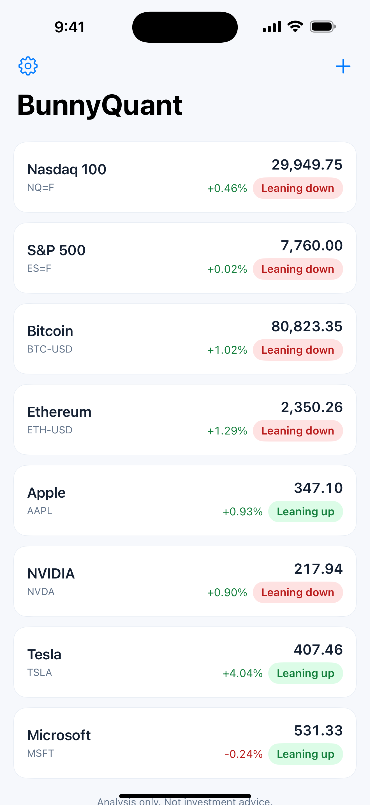
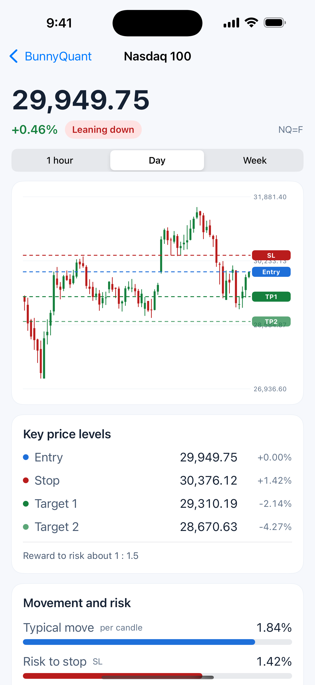
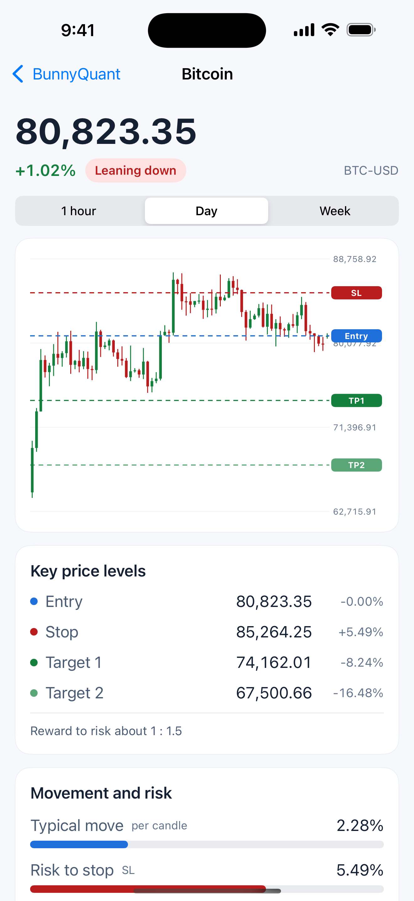
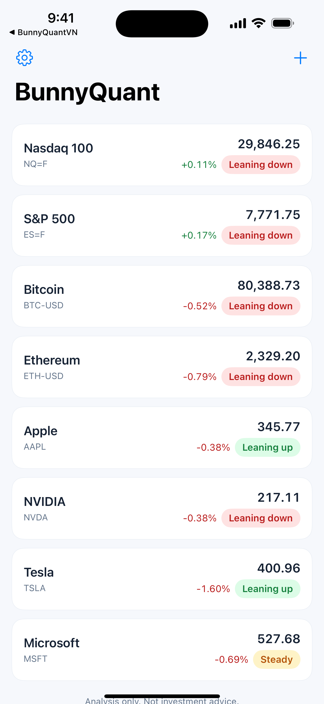
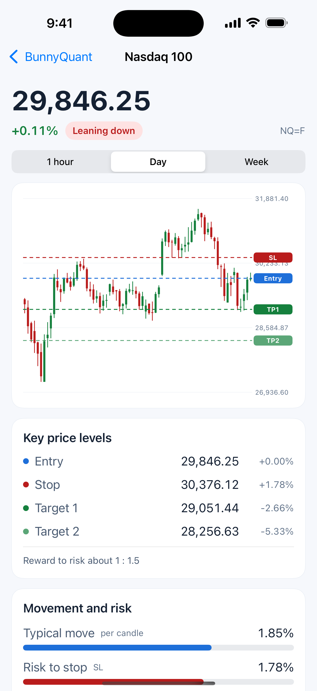
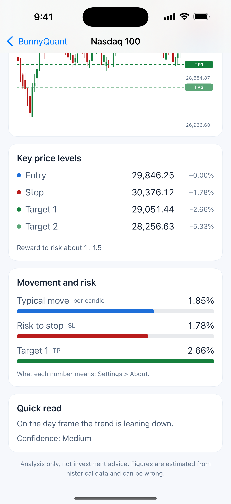

# BunnyQuant for iPhone and iPad

**Developer: Dr. Nam H. Le** · © 2026 Dr. Nam H. Le · [drnamlabs.com](https://drnamlabs.com) · [bunnyquant.com](https://bunnyquant.com)

Swift / SwiftUI client of BunnyQuant: a watchlist, native candlestick charts drawn with SwiftUI Canvas, and entry, stop-loss and take-profit levels with a movement-and-risk card. Free; every install gets its own anonymous account verified with Apple App Attest.

  

Source published for reading and portfolio purposes only; all rights reserved (see `LICENSE`). The analysis runs on private servers and is not part of this repository.

---

# BunnyQuant (Swift)

Dr. Nam H. Le. drnamlabs.com, bunnyquant.com

App iPhone cho khách, viết bằng Swift/SwiftUI thuần (không thư viện ngoài, không web view), thay app Expo/React Native ở `../BunnyQuantApp`. Bundle `com.bunnyquant.app`, iOS 17+, chỉ iPhone, chỉ giao diện sáng, vi/en theo máy.

## Build
```sh
cd iOS_app/BunnyQuantSwift && xcodegen
# Simulator
xcodebuild -project BunnyQuant.xcodeproj -scheme BunnyQuant -destination "generic/platform=iOS Simulator" build
# Thiết bị: thêm cờ khóa App Store Connect (xem memory ios-app-state), -configuration Release
```
Chạy với máy chủ dev: thêm `BQ_API_BASE=http://127.0.0.1:PORT/api` vào lệnh build (mặc định `https://bunnyquant.com/api`). Cờ debug (chỉ bản Debug): `-debugOpen NQ=F` mở thẳng màn hình mã, `-debugSheet settings|add`.
App Attest KHÔNG chạy trong Simulator: ở đó app gửi đăng ký không kèm khóa (chỉ máy chủ dev để tắt kiểm tra mới nhận). Entitlement: Debug = `development`, Release = `production`.

## Đăng nhập (mỗi lần cài một tài khoản riêng)
1. `GET /ios/challenge` -> `{challenge}`.
2. Apple App Attest: `generateKey` + `attestKey(clientDataHash = SHA256(challenge))`.
3. `POST /ios/register {key_id, attestation(base64), challenge}` -> `{access_token, refresh_token, expires_in, user_id}`. Phiên lưu trong Keychain.
4. Mọi lệnh gọi khác dùng `Authorization: Bearer`; gần hết hạn thì `POST /ios/refresh {refresh_token}`; 401 thì làm mới và thử lại một lần.
Tùy chọn: đăng nhập bằng tài khoản bunnyquant.com (`/auth/proxy/token`, như app cũ); đăng xuất thì quay về tài khoản của máy.

## Dùng các endpoint có sẵn
`GET /quick-decision/{mã}?market&interval&lookback&horizon=swing` (đã gồm `candles` và `price_context`), `GET/POST/DELETE /api/watchlist` (đường dẫn thực tế `/api/api/watchlist`), `GET /tickers/{us|crypto|futures}`, `DELETE /api/account`.

## Cố ý không có
Tên gói, giá, nút nâng cấp, mua trong app, đặt lệnh, thông báo đẩy, tên phương pháp và tên gói (chỉ dùng từ thường: biến động, rủi ro, cắt lỗ, chốt lời). Hết lượt trong ngày chỉ báo "hôm nay vậy là đủ rồi", không hiện con số. Kết quả được giữ trên máy tới khi nến đóng nên mở lại app không tốn lượt.

## Screenshots

Real candles from public market data; the entry, stop-loss and take-profit lines in these pictures are sample values for illustration, not output of the production server. The app is light-theme only by design.






Watchlist · Candlestick chart with entry, stop-loss and take-profit · Key price levels and the movement-and-risk card · Another symbol
